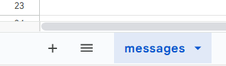
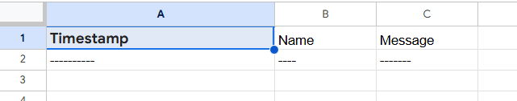
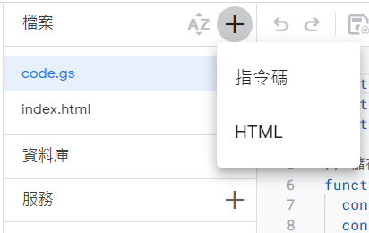

# Message Board

一個使用 Google Apps Script 和 Google Sheets 製作的匿名留言板。

留言不需要註冊帳號，送出後會存進 Google 試算表。這個專案主要是拿來練習前端開發，以及串接 Google Apps Script 與 Google Sheets。

**線上版本：** [匿名留言板](https://script.google.com/macros/s/AKfycbybwJuz5dCB4jku0RihI11GDsJ_7Fk6rW_0QGrQrPzl7S8OorYfsn9LZ6ugz7Qu7vo/exec)

## 功能

- 匿名留言，不需要註冊帳號
- 將留言時間、名稱與內容儲存到 Google Sheets
- 送出留言時停用按鈕，避免連續點擊造成重複提交
- 加入 hover 動畫效果

## 使用技術

- **Frontend:** HTML、CSS、JavaScript
- **Backend:** Google Apps Script
- **Storage:** Google Sheets

## 專案結構

```text
Message-Board/
├── index.html    # 前端頁面
├── Code.gs       # Apps Script 後端程式
├── image/        # 使用的圖片
└── README.md
```

## 如何自行部署

### 1. 建立 Google 試算表

1. 開啟 [Google Sheets](https://docs.google.com/spreadsheets/) 並建立新的試算表。
2. 將試算表命名為「留言板」，工作表名稱改為 `messages`。
3. 在第一列建立以下欄位：

   | A | B | C |
   |---|---|---|
   | 時間 | 名稱 | 留言 |

   

   

4. 從試算表網址取得 Spreadsheet ID。

   網址格式：

   ```text
   https://docs.google.com/spreadsheets/d/SPREADSHEET_ID/edit
   ```

   複製 `SPREADSHEET_ID` 的部分，後續會用到。

### 2. 建立 Google Apps Script 專案

1. 開啟 [Google Apps Script](https://script.google.com/)。
2. 建立新專案，將 `Code.gs` 的程式碼貼上。
3. 修改 `SHEET_ID`，填入剛才取得的試算表 ID。
4. 修改 `MY_TITLE`，設定留言板顯示的標題。

### 3. 加入前端頁面

1. 在 Apps Script 編輯器中新增 HTML 檔案，命名為 `index`。
2. 將 `index.html` 的內容貼上。

   

### 4. 部署成網頁

1. 點選「部署」→「新增部署」。
2. 類型選擇「網頁應用程式」。
3. 依需求設定執行身分與存取權限。
4. 如果要讓訪客直接留言，需設定適當的存取權限；選擇「任何人」代表任何人都可能存取這個端點。
5. 點選「部署」，完成授權後複製產生的網址。

完成後，就可以透過該網址開啟留言板。

## 注意事項

- 如果修改了 Apps Script 程式碼，可能需要建立新版本並重新部署，線上網站才會套用變更。
- 公開留言板可能收到垃圾訊息或惡意請求，正式公開前加入輸入驗證、提交頻率限制及其他防濫用措施。
- 不要將敏感資訊或個資直接寫入公開的程式碼或試算表。
